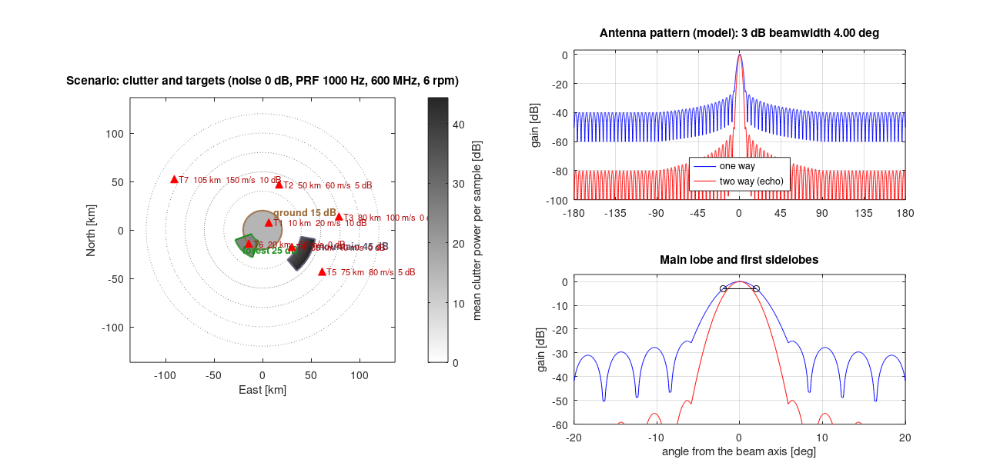
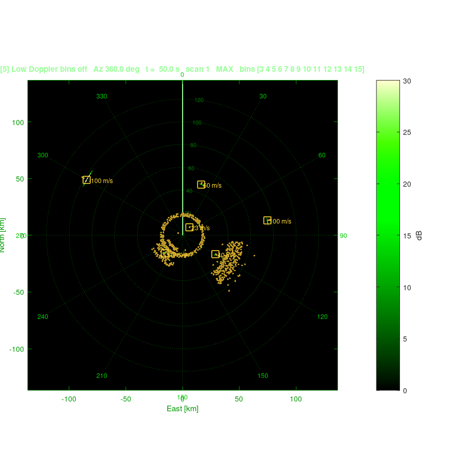
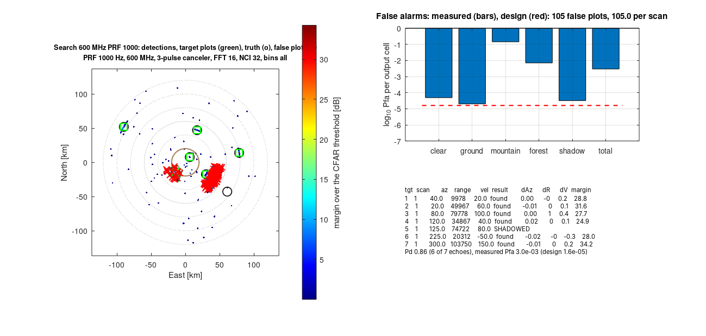
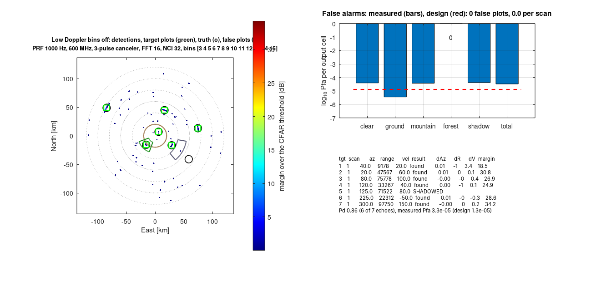

# شبیه‌ساز رادار جست‌وجوی دوبعدی چرخشی (PPI) در MATLAB

| مشخصه | پیاده‌سازی |
|---|---|
| نوع شبیه‌سازی | رادار دوبعدی چرخشی با نمایشگر PPI، پالس به پالس |
| خروجی | تصویری (PPI زنده، شکل خلاصهٔ هر اسکن، نقشهٔ سناریو و پترن آنتن) و عددی (جدول‌ها، فایل‌های CSV و MAT) |
| ردیابی | ندارد. خروجی پلات است: برد، سمت، سرعت شعاعی و حاشیه بالای آستانه |
| محیط | نویز گیرنده، کلاتر زمین، کوه و جنگل، سایهٔ کوه، هشدار کاذب (اندازه‌گیری‌شده در هر ناحیه) |
| زبان | MATLAB (R2016b به بعد). بدون جعبه‌ابزار. در GNU Octave 7 به بعد هم اجرا می‌شود |

```
اهداف + کلاتر (زمین/کوه/جنگل) + نویز ─► ویدئو ─► دیکودر ─► کنسلر ۲ یا ۳ پالسی ─► FFT داپلر ─► انتگرال‌گیری ─► CFAR ─► بیشینه روی بین‌ها ─► پلات / PPI
     (پترن آنتن، چرخش، PRF، فرکانس حامل)
```

## اجرای سریع

1. **`main_ppi`**: سناریوی کامل. نخست نقشهٔ کلاتر، اهداف و پترن آنتن را رسم می‌کند. سپس
   پنج اسکن زمان‌بندی‌شده را روی یک PPI زنده اجرا می‌کند. برای هر اسکن جدول بودجهٔ لینک، جدول
   اهداف در برابر پلات‌ها و جدول هشدار کاذب هر ناحیه را چاپ می‌کند. در پایان همه چیز را در
   `results/run_<تاریخ>/` ذخیره می‌کند.
2. **`rsp_selftest`**: آزمون صحت همهٔ بلوک‌ها (62 آزمون).
3. **`main_scan`**: سناریوی سادهٔ سه‌هدفه، دو دور آنتن، و بازپخش با سرعت واقعی.

مقدارهای رادار شما در `radar_params.m` قرار می‌گیرند. همهٔ پارامترها در `rsp_default_params.m`
توضیح داده شده‌اند.

## ساختار ماژولار

| ماژول | فایل |
|---|---|
| پارامترها | `radar_params.m`، `rsp_default_params.m` |
| شکل موج و دیکودر | `rsp_waveform.m`، `rsp_code.m`، `rsp_code_mmf.m`، `rsp_decoder.m`، `rsp_matched_filter.m` |
| پترن آنتن | `rsp_antenna_pattern.m` (مدل‌های داخلی)، `rsp_antenna_load.m` (بارگذاری پترن دلخواه)، `patterns/` |
| کلاتر و محیط | `rsp_clutter_types.m` (پیش‌فرض‌های زمین، کوه و جنگل)، `rsp_clutter_mask.m`، `rsp_clutter_shadow.m`، `rsp_clutter_region.m` |
| شبیه‌ساز | `rsp_simulate.m` (ویدئو)، `rsp_truth.m` (موقعیت درست اهداف)، `rsp_geometry.m`، `rsp_levels.m` |
| کنسلر MTI | `rsp_canceler.m`، `rsp_canceler_taps.m` |
| FFT و انتگرال‌گیری | `rsp_doppler_fft.m`، `rsp_nci.m`، `rsp_window.m` |
| CFAR و آشکارسازی | `rsp_cfar*.m`، `rsp_extract_plots.m` |
| اسکن و زمان‌بندی | `rsp_scan.m` (یک اسکن)، `rsp_schedule.m` و `rsp_schedule_print.m` (زمان‌بندی) |
| هشدار کاذب | `rsp_false_alarms.m` |
| نمایش | `rsp_ppi_init.m`، `rsp_ppi_update.m`، `rsp_ppi_replay.m`، `rsp_plot_summary.m`، `rsp_plot_scenario.m` |
| ذخیره | `rsp_save.m` |
| آزمون صحت | `rsp_selftest.m`، `rsp_budget.m` (پیش‌بینی نظری) |

## پارامترهای اصلی

| قابلیت | پارامتر | پیش‌فرض |
|---|---|---|
| فرکانس حامل | `P.radar.fcMHz` | 600 MHz (λ = 0.5 m) |
| PRF | `P.radar.prfHz` | 1000 Hz |
| سرعت چرخش آنتن | `P.radar.rpm` | 6 rpm (هر دور 10 ثانیه) |
| کنسلر دو یا سه پالسی | `P.canceler.order` (2 یا 3) یا ضرایب دلخواه در `P.canceler.weights` | 3 |
| تعداد پالس‌های FFT (انتگرال‌گیری همدوس) | `P.fft.nPulses` و `P.fft.nfft` | 16 |
| انتگرال‌گیری غیرهمدوس | `P.nci.nFrames` | 32 |
| بین‌های داپلر خروجی | `P.output.bins` (مثلاً `3:15` بدون بین‌های نزدیک صفر) | همه |
| CFAR | `P.cfar.type` (SO، CA یا GO)، `P.cfar.pfa` | SO و 1e-6 |

با تغییر فرکانس حامل یا PRF، این مقدارها به‌صورت خودکار دوباره محاسبه می‌شوند:

* سرعت بدون ابهام: ±λ·PRF/4
* برد بدون ابهام: c/2PRF
* درجه به ازای هر پالس
* تبدیل بین داپلر به سرعت

بودجهٔ لینک (`rsp_budget`) هم با تنظیمات جدید محاسبه می‌شود.

مثال: در 1300 MHz و PRF برابر 1500، سرعت بدون ابهام ±86 m/s است. هدف 100 m/s در این حالت
−73 m/s اندازه‌گیری می‌شود و آزمون صحت همین را بررسی می‌کند. برد بدون ابهام 100 km است و
پژواک هدفی دورتر از آن، از پالس قبلی و در بردِ تاشده دیده می‌شود.

## پترن آنتن و بارگذاری پترن دلخواه

مدل‌های داخلی با `P.antenna.type` انتخاب می‌شوند:

* `'model'`: لوب اصلی گاوسی، پوش لوب‌های فرعی (−25 dB) و لوب پشتی (−40 dB)
* `'sinc'`: روزنهٔ یکنواخت با لوب فرعی −13.3 dB
* `'gaussian'`: فقط لوب اصلی

برای پترن دلخواه:

```matlab
P.antenna = rsp_antenna_load(P.antenna, 'patterns/example_pattern.csv');
```

* **فایل `.csv` یا `.txt`:** دو ستون. ستون اول زاویه از محور بیم [درجه] و ستون دوم بهره
  یک‌طرفه [dB]. یک سطر عنوان مجاز است. زاویه‌ها می‌توانند −180..180، 0..360 یا 0..180 (متقارن) باشند.
* **فایل `.mat`:** متغیرهای `angleDeg` و `gainDb`.
* **بدون فایل:** `P.antenna.type = 'table'` و پر کردن `patternDeg` و `patternDb`.

پترن به قلهٔ 0 dB نرمال می‌شود و پهنای بیم 3 dB از خود جدول اندازه‌گیری می‌شود. بنابراین
استخراج پلات، کلاتر و بودجهٔ لینک همگی از پترن بارگذاری‌شده پیروی می‌کنند. پژواک هدف از
پترن دوطرفه استفاده می‌کند. فایل نمونه یک آرایهٔ ۳۲ عنصری با وزن‌دهی Taylor است (پهنای بیم
4.0 درجه، لوب فرعی −30 dB).

## محیط: نویز، کلاتر کوه و جنگل، هشدار کاذب

`S.clutter` آرایه‌ای از لایه‌هاست و هر لایه یک ناحیه است. همهٔ فیلدها به‌جز `type` اختیاری‌اند
و مقدار پیش‌فرض نوعشان را می‌گیرند. فهرست کامل فیلدها در `rsp_clutter_types` آمده است.

```matlab
S.clutter = struct('type', {'ground', 'mountain', 'forest'});
S.clutter(2).azDeg  = [100 140];      % قطاع سمت [درجه]
S.clutter(2).rangeM = [40000 55000];  % گسترهٔ برد [متر]
```

| نوع | توان | حرکت داخلی | سهم ایستا | بافت | ویژگی |
|---|---|---|---|---|---|
| زمین (`ground`) | 10 dB | 0.1 m/s | 0.9 | 3 dB | |
| کوه (`mountain`) | 45 dB در خط‌الرأس | 0.05 m/s | 0.98 | 6 dB | شیب +10 dB به سمت خط‌الرأس، سایهٔ −40 dB پشت کوه |
| جنگل (`forest`) | 20 dB | 0.6 m/s (باد) | 0.5 | 4 dB | |

* **مدل فیزیکی:** هر لایه از دو بخش مستقل ساخته می‌شود: بخش ایستا (صخره، تنهٔ درخت) و بخش
  متحرک (شاخ و برگ در باد). طیف هر بخش زنگوله‌ای است و انحراف معیار درخواستی را دارد. پهن‌شدگی
  ناشی از چرخش آنتن هم به هر دو بخش اضافه می‌شود: 0.265·PRF / تعداد پالس در یک پهنای بیم، که
  اینجا 0.6 m/s است. نقشهٔ توان متوسط شامل این‌هاست:
  * بافت لاگ-نرمال
  * لبه‌های نرم
  * شیب کوه
  * سایهٔ کوه‌های جلوتر

  این نقشه در سمت با پترن دوطرفهٔ آنتن هموار می‌شود. کوه، کلاتر و اهداف پشت خود را پنهان
  می‌کند. سطح‌ها توان به ازای هر نمونه در گیرنده‌اند و مقیاسشان همان مقیاس نویز (`S.noiseDb`) است.
* **هشدار کاذب:** `rsp_false_alarms` آشکارسازی‌هایی را که نزدیک هیچ عبور هدفی نیستند هشدار
  کاذب می‌شمارد. پلات‌هایی را هم که با هیچ هدفی جور نمی‌شوند پلات کاذب می‌شمارد. هر دو جداگانه
  برای هر ناحیه شمرده می‌شوند: صاف، زمین، کوه، جنگل و سایه. احتمال هشدار کاذب اندازه‌گیری‌شده
  با مقدار طراحی 1 − (1 − Pfa)^nBins مقایسه می‌شود. این جدول بعد از هر اسکن چاپ و ذخیره می‌شود.
* **پدیدهٔ واقعی:** کنسلر کلاتر کوه را تا کف نویز پایین می‌آورد. ولی باقیماندهٔ آن در
  بین‌های داپلر نزدیک صفر جمع می‌شود. در آن بین‌ها نویز هم بسیار کم است، پس روی کوه هشدار کاذب
  زیاد می‌شود. اسکن «Low Doppler bins off» نشان می‌دهد که حذف این بین‌ها (`P.output.bins = 3:15`)
  چه اثری دارد. کنسلر دو پالسی هم باقیماندهٔ بیشتری دارد.

## زمان‌بندی اسکن‌ها

```matlab
sched = struct('name',  {'Search', '2-pulse', 'PRF 1500, L band'}, ...
               'turns', {1, 1, 1}, ...
               'gapS',  {0, 0, 5}, ...                       % مکث پیش از اسکن [ثانیه]
               'set',   {{}, {'canceler.order', 2}, {'radar.prfHz', 1500, 'radar.fcMHz', 1300}});
run = rsp_schedule(P, S, sched);
```

* هر ردیف از `P` پایه شروع می‌کند و فقط مقدارهایی را که در `set` آمده تغییر می‌دهد. می‌توان
  یک تابع `apply` هم داد.
* به جای `turns` می‌توان `degrees` داد، مثلاً 90 برای یک قطاع.
* زمان و سمت از یک اسکن به اسکن بعد ادامه پیدا می‌کنند، پس اهداف حرکتشان را ادامه می‌دهند.
  در `gapS` آنتن می‌چرخد ولی فرستنده خاموش است.
* PPI بین اسکن‌ها مشترک است.
* `run.timeline` برای هر ردیف این‌ها را دارد:
  * زمان شروع و پایان و سمت شروع
  * PRF، فرکانس حامل، برد و سرعت بدون ابهام
  * تعداد پالس، نوع کنسلر، طول FFT و NCI
  * تعداد اهداف یافته‌شده، پلات‌های کاذب و Pfa اندازه‌گیری‌شده

## خروجی‌ها و ذخیره

`rsp_save(run, folder)` این فایل‌ها را می‌نویسد. اگر پوشه خالی باشد، `results/run_<تاریخ>/` ساخته می‌شود.

| فایل | محتوا |
|---|---|
| `results.mat` | همهٔ نتایج (متغیر `result`) |
| `plots.csv` | پلات‌ها: برد، سمت، سرعت، حاشیه، کاذب یا نه |
| `detections.csv` | همهٔ آشکارسازی‌ها |
| `report.csv` | هر عبور هدف در برابر پلات آن و خطاها |
| `budget.csv` | بودجهٔ لینک |
| `falsealarms.csv` | هشدار کاذب هر ناحیه |
| `timeline.csv` | جدول زمان‌بندی |
| `summary.txt` | جدول‌های چاپی |
| `ppi.png`، `summary_<k>.png`، `scenario.png` | تصاویر |

بازخوانی نتایج:

```matlab
s = load('results/run_.../results.mat');
t = dlmread('results/run_.../plots.csv', ',', 1, 0);
```

برای بازپخش یک اسکن روی PPI: `rsp_ppi_replay(run.scans(1), 'speed', 4)`.

## نتیجهٔ اجرای `main_ppi`

هر ردیف یک دور آنتن است. این اجرا در Octave انجام شده است.

| # | اسکن | اهداف یافته‌شده | پلات کاذب | Pfa اندازه‌گیری‌شده (طراحی) | Pfa کوه / جنگل |
|---|---|---|---|---|---|
| 1 | 600 MHz، PRF 1000، کنسلر سه پالسی، FFT 16 | 6 از 7 | 105 | 3.0e-3 (1.6e-5) | 1.4e-1 / 7.1e-3 |
| 2 | کنسلر دو پالسی | 6 از 7 | 326 | 1.2e-2 (1.6e-5) | 1.6e-1 / 1.1e-1 |
| 3 | FFT سی‌ودو پالسی، NCI 16 | 6 از 7 | 182 | 6.4e-3 (3.2e-5) | 2.1e-1 / 8.7e-2 |
| 4 | PRF 1500 و 1300 MHz | 5 از 7 | 66 | 2.5e-3 (1.6e-5) | 7.4e-2 / 1.0e-2 |
| 5 | بدون بین‌های داپلر نزدیک صفر (`3:15`) | 6 از 7 | 0 | 3.3e-5 (1.3e-5) | 3.8e-5 / 0 |

* **هدف ۵ (پشت کوه):** در هیچ اسکنی دیده نمی‌شود. بودجهٔ لینک هم حاشیهٔ −4 dB پیش‌بینی می‌کند،
  یعنی زیر آستانه.
* **هدف ۷ (۱۵۰ m/s):** سرعتش −99.6 m/s اندازه‌گیری می‌شود، چون سرعت در ±125 m/s تا می‌خورد.
  در اسکن ۴ (PRF 1500) این هدف در بُرد 99.3 km است، یعنی درست پیش از برد بدون ابهام 99.9 km.
  پژواک 100 میکروثانیه‌ای آن با ارسال پالس بعدی بریده می‌شود (eclipsing) و CFAR آن را بررسی
  نمی‌کند.
* **علت هشدار کاذب روی کوه و جنگل:** باقیماندهٔ کلاتر در بین‌های کنار داپلر صفر جمع می‌شود.
  کنسلر در همان بین‌ها نویز را هم تضعیف کرده است، پس این باقیمانده از آستانه بالاتر می‌رود.
  * کنسلر دو پالسی وضع را بدتر می‌کند، حتی روی زمین.
  * حذف بین‌های 1، 2 و 16 هشدارهای کاذب را از بین می‌برد. هزینه‌اش این است که هدف ۱ (20 m/s،
    بین 2) حدود 10 dB حاشیه از دست می‌دهد و سرعتش 3.4 m/s خطا پیدا می‌کند.
* **خطای اهداف آشکارشده:** حداکثر 0.02 درجه در سمت، 1 متر در برد و 0.4 m/s در سرعت.






## آزمون صحت (`rsp_selftest`)

هر بلوک با یک محاسبهٔ مستقل یا با فرمول بسته مقایسه می‌شود:

1. کدها و دیکودرها (PSL، هم‌ترازی برد، مقایسه با حلقهٔ مستقیم)
2. کنسلر دو، سه و چهار پالسی
3. FFT داپلر با 16 و 32 پالس
4. انتگرال‌گیری
5. CFAR در هر سه نوع و فرمول بستهٔ ضریب آستانه
6. شبیه‌ساز: پژواک برابر سیگنال ارسالی تأخیریافته × فاز حامل؛ فاز داپلر؛ توان نویز و کلاتر
7. پترن sinc و پترن بارگذاری‌شده از فایل CSV و MAT (مقدارها و پهنای بیم اندازه‌گیری‌شده)
8. کلاتر جنگل: توان و پهنای طیف
9. سایهٔ کوه روی کلاتر و روی هدف، و نقشهٔ ناحیه‌ها
10. پژواک فراتر از برد بدون ابهام
11. یک هدف در کل زنجیره با کنسلر دو پالسی، با FFT سی‌ودو پالسی، و با PRF برابر 1500 و حامل
    1300 MHz (تاشدگی سرعت). در هر حالت، خطا و حاشیه با بودجهٔ لینک مقایسه می‌شود.
12. سناریوی سه‌هدفه: خطای سمت، برد و سرعت و حاشیهٔ CFAR در برابر بودجه؛ Pfa روی نویز
13. پیوستگی زمان و سمت در زمان‌بندی، و جمع شمارش هشدار کاذب
14. ذخیره و بازخوانی فایل‌ها
